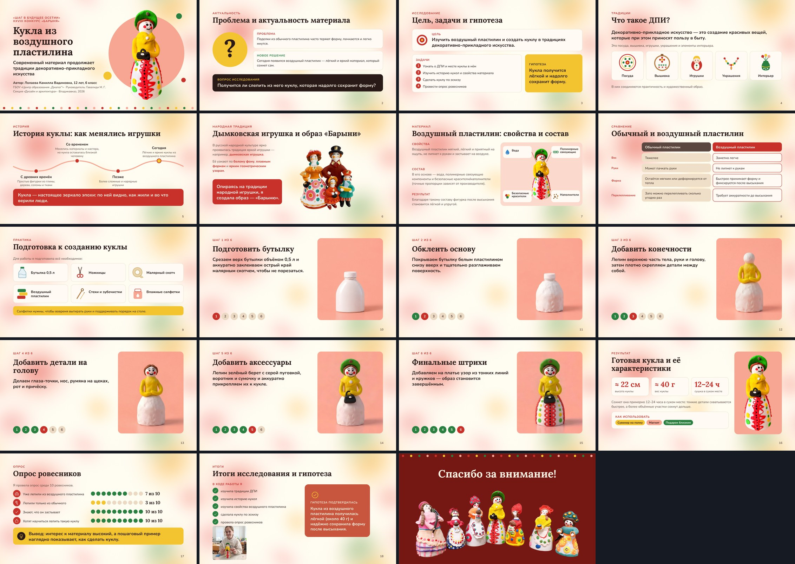

# check: presentations/kukla-iz-vozdushnogo-plastilina.pptx

- Папка результата: `/home/user/prezintacia/checks/runs/20261123-171607-check-kukla-iz-vozdushnogo-plastilina`
- Время: **10940.3 ms** · шаги: анализ структуры 225.0 ms, рендер слайдов (LibreOffice WASM) 28.2 ms, контакт-лист 1049.3 ms, проверка качества (lint) 1037.5 ms, запуск Chromium 544.7 ms, скриншоты слайдов: desktop, phone 7030.6 ms, контакт-лист desktop 598.7 ms, контакт-лист phone 224.7 ms

## kukla-iz-vozdushnogo-plastilina.pptx

- Слайдов: **19**, размер 33.87×19.05 см, файл 5778.1 KB
- Шрифты: `Nunito`, `Lora`, `Lora (theme)`, `Nunito (theme)`
- Проблемы: 🛑 0 · ⚠️ 0 · ℹ️ 0 → `kukla-iz-vozdushnogo-plastilina/lint.md`

## Проверка качества

✅ Проблем не найдено.

## kukla-iz-vozdushnogo-plastilina.html (HTML)

### desktop 1600×900 — 19 слайдов, 5431 ms

✅ Ничего не выходит за экран, текст не переполнен.
### phone 390×844 — 19 слайдов, 1598 ms

✅ Ничего не выходит за экран, текст не переполнен.

✅ Ошибок JavaScript нет.
