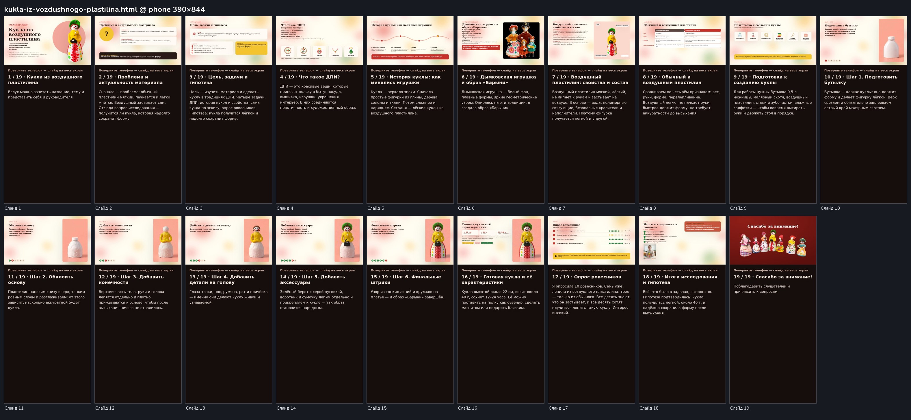

# check: presentations/kukla-iz-vozdushnogo-plastilina.pptx

- Папка результата: `/home/user/prezintacia/checks/runs/20261123-180358-check-kukla-iz-vozdushnogo-plastilina`
- Время: **10250.7 ms** · шаги: анализ структуры 234.1 ms, рендер слайдов (LibreOffice WASM) 32.5 ms, контакт-лист 1010.2 ms, проверка качества (lint) 982.9 ms, запуск Chromium 457.9 ms, скриншоты слайдов: desktop, phone 6548.0 ms, контакт-лист desktop 589.2 ms, контакт-лист phone 209.4 ms

## kukla-iz-vozdushnogo-plastilina.pptx

- Слайдов: **19**, размер 33.87×19.05 см, файл 7019.1 KB
- Шрифты: `Nunito`, `Lora`, `Lora (theme)`, `Nunito (theme)`
- Проблемы: 🛑 0 · ⚠️ 0 · ℹ️ 0 → `kukla-iz-vozdushnogo-plastilina/lint.md`

## Проверка качества

✅ Проблем не найдено.

## kukla-iz-vozdushnogo-plastilina.html (HTML)

### desktop 1600×900 — 19 слайдов, 5145 ms

✅ Ничего не выходит за экран, текст не переполнен.
### phone 390×844 — 19 слайдов, 1401 ms

✅ Ничего не выходит за экран, текст не переполнен.

✅ Ошибок JavaScript нет.
